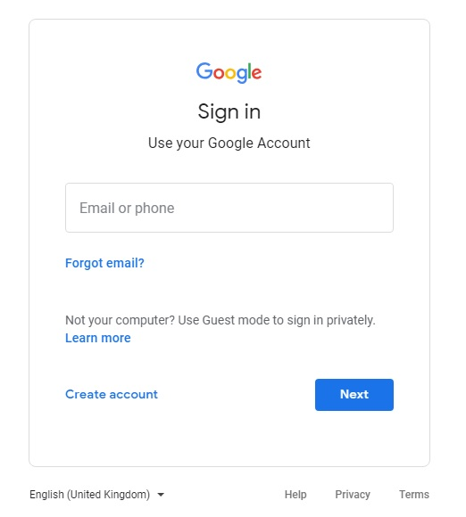
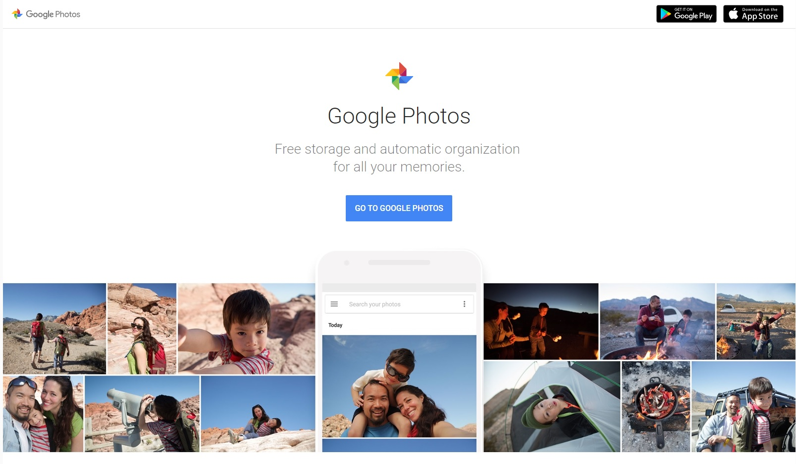
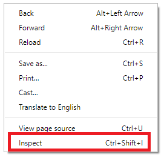
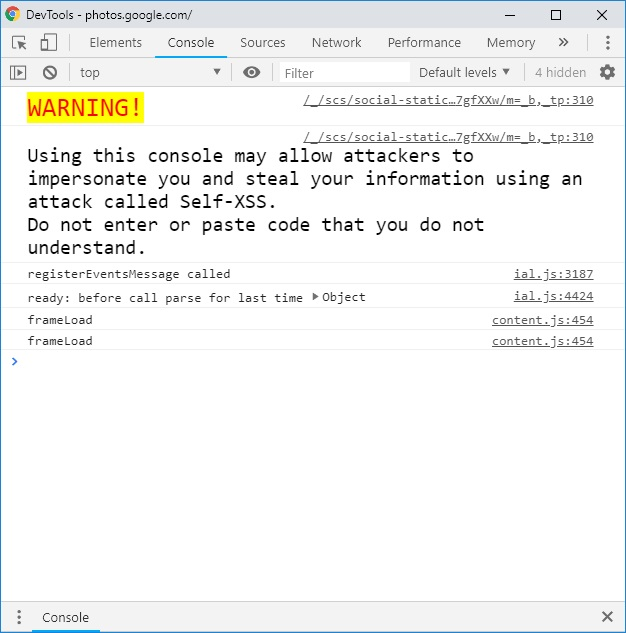

**See my blog at: [https://mrishab.io](https://mrishab.io)** to read more about my projects and open-source contributions.  
**You can support my work by donating to: [https://ko-fi.com/mrishab](https://ko-fi.com/mrishab)**

---

# Google Photos Delete Tool

A lightweight, robust, open-source browser script to bulk delete thousands of photos and albums from [Google Photos](https://photos.google.com/) automatically.

Google Photos does not provide a native "Select All" or "Delete All" button. Deleting thousands of photos manually takes hours of tedious clicking. This tool automates the selection and confirmation cycles right inside your web browser. You can visually watch the deletion happen in real-time, completely client-side without sharing your credentials with third parties.

---

## Table of Contents
- [Quick Start](#-quick-start)
- [Targeted & Date-Filtered Deletions](#-targeted--date-filtered-deletions)
- [Ultra-Fast Lightweight View](#-ultra-fast-lightweight-view-recommended)
- [Deleting Albums](#-deleting-albums-delete_albumsjs)
- [Restoring Photos from Trash](#-restoring-photos-from-trash-restore_photosjs)
- [Quick Alternative: Native Shift + Click (For Small Batches)](#-quick-alternative-native-shift--click-for-small-batches)
- [For AI Agents (Agentic Era)](#-for-ai-agents-agentic-era)
- [Detailed Step-by-Step Guide (For Everyone)](#-detailed-step-by-step-guide-for-everyone)
  - [Prerequisites](#prerequisites)
  - [Step 1: Open Google Photos in English](#step-1-open-google-photos-in-english)
  - [Step 2: (Optional) Disable Images for Speed & Low RAM](#step-2-optional-disable-images-for-speed--low-ram)
  - [Step 3: Open Browser Developer Tools](#step-3-open-browser-developer-tools)
  - [Step 4: Allow Pasting in DevTools (Chrome Requirement)](#step-4-allow-pasting-in-devtools-chrome-requirement)
  - [Step 5: Run the Script](#step-5-run-the-script)
- [Alternative: 1-Click Bookmarklet](#-alternative-1-click-bookmarklet)
- [How to Stop the Script](#-how-to-stop-the-script)
- [Speed Tips (Delete Faster)](#-speed-tips-delete-faster)
- [Configuration](#-configuration)
- [Troubleshooting](#-troubleshooting)
- [FAQs](#-faqs)

---

## ⚡ Quick Start

If you already know how to use your browser's Developer Console:

1. Open **[photos.google.com/?hl=en](https://photos.google.com/?hl=en)** (or the [lightweight search view](#-ultra-fast-lightweight-view-recommended)).
2. Press `Ctrl + Shift + I` (Windows/Linux) or `Cmd + Option + I` (Mac) to open Developer Tools, then click the **Console** tab.
3. *If Chrome asks, type `allow pasting` and hit Enter.*
4. Copy and paste the contents of **[delete_photos.js](delete_photos.js)** into the console and press **Enter**.
5. Watch it delete your photos automatically in batches!

---

## 📅 Targeted & Date-Filtered Deletions

Want to delete photos before a specific date, from a specific year, or only large videos? You do **not** need complex scripts — Google Photos supports powerful search filters. Simply navigate to the filtered URL below, then run `delete_photos.js`:

| Target | URL to Open Before Running Script | Purpose |
| :--- | :--- | :--- |
| **Before June 1, 2021** | `https://photos.google.com/search/before:2021-06-01?hl=en` | Deletes photos uploaded before Google ended free unlimited storage |
| **Specific Year (e.g. 2020)** | `https://photos.google.com/search/2020?hl=en` | Cleans out an entire calendar year |
| **All Videos Only** | `https://photos.google.com/search/videos?hl=en` | Immediately reclaims massive quota space |
| **All Screenshots Only** | `https://photos.google.com/search/screenshots?hl=en` | Purges clutter without touching personal photos |
| **Date Range** | `https://photos.google.com/search/after:2018-01-01%20before:2020-01-01?hl=en` | Deletes within an exact historical window |

---

## 🚀 Ultra-Fast Lightweight View (Recommended)

When deleting tens of thousands of photos, the main Google Photos home stream can become heavy because it loads timeline headers, memory widgets, and utility cards.

Community members and [Brown University IT](https://ithelp.brown.edu/kb/articles/mass-delete-google-photos) recommend using Google Photos' clean search view instead:
👉 **[https://photos.google.com/search/CgAiCgoAEgYKBHICCgAo2IPP9NQy?hl=en](https://photos.google.com/search/CgAiCgoAEgYKBHICCgAo2IPP9NQy?hl=en)**

**Why this is faster:**
- Bypasses home feed memory cards and heavy timeline widgets.
- Renders an ultra-fast photo grid.
- Allows the browser to process 200–400 photos per batch with minimal memory usage.

---

## 📁 Deleting Albums (`delete_albums.js`)

If you have hundreds or thousands of empty or duplicate albums (often created unintentionally by syncing tools like `rclone` or third-party backup utilities), use the dedicated album deletion tool:

1. Navigate to **[https://photos.google.com/albums?hl=en](https://photos.google.com/albums?hl=en)**.
2. Open Developer Tools (`Ctrl + Shift + I` or `Cmd + Option + I`) and click the **Console** tab.
3. Copy and paste **[delete_albums.js](delete_albums.js)** into the console and press **Enter**.
4. The tool will iterate through each album, open its options menu, click "Delete album", and confirm the prompt automatically.
5. To stop anytime, type `stopGooglePhotosAlbumDelete()` and hit Enter.

*(Note: Deleting an album does **not** delete the photos inside it from your main library; it only deletes the album collection).*

---

## ♻️ Restoring Photos from Trash (`restore_photos.js`)

Accidentally deleted photos or changed your mind? Google Photos does not provide a "Restore All" button in the Trash. If you need to recover thousands of photos from the Trash bin:

1. Navigate to **[https://photos.google.com/trash?hl=en](https://photos.google.com/trash?hl=en)**.
2. Open Developer Tools (`Ctrl + Shift + I` or `Cmd + Option + I`) and click the **Console** tab.
3. Copy and paste **[restore_photos.js](restore_photos.js)** into the console and press **Enter**.
4. The tool will auto-zoom, select photos in batches, click the "Restore" button, and return them back to your main library automatically.
5. To stop anytime, type `stopGooglePhotosRestore()` and hit Enter.

---

## 🖱️ Quick Alternative: Native Shift + Click (For Small Batches)

If you only have 200–500 photos to delete, you can use Google Photos' native shift-select feature without opening DevTools:

1. Click the checkmark circle on the first photo.
2. Hold down the **Shift** key on your keyboard.
3. Scroll down ~300 to 500 photos.
4. While still holding Shift, hover over the last photo — notice the entire block between the first and last photo turns shaded.
5. Click the last photo to select the entire batch, then click the **Trash icon** in the top toolbar.
6. *(For thousands of photos, use `delete_photos.js` instead to automate this unattended).*

---

## 🤖 For AI Agents (Agentic Era)

If you are using an AI browser agent (such as Claude Computer Use, ChatGPT Operator, Chrome AI, or open-source browser agents), you can give it this prompt:

```text
Please help me delete all photos from my Google Photos account using the open-source script from https://github.com/mrishab/google-photos-delete-tool.

Instructions:
1. Navigate to https://photos.google.com/?hl=en (or https://photos.google.com/search/CgAiCgoAEgYKBHICCgAo2IPP9NQy?hl=en for high speed).
2. Open the browser Developer Tools Console.
3. If prompted by the browser about pasting, type "allow pasting" into the console and submit.
4. Copy the raw JavaScript code from https://raw.githubusercontent.com/mrishab/google-photos-delete-tool/master/delete_photos.js and execute it in the console.
5. Monitor progress until all photos are deleted or until no more photos remain.
```

---

## 📖 Detailed Step-by-Step Guide (For Everyone)

No technical background is required! Follow these steps carefully:

### Prerequisites
- Any modern web browser (Google Chrome, Mozilla Firefox, Microsoft Edge, Brave, Safari, Chromium).
- You are logged into your Google account.

---

### Step 1: Open Google Photos in English
1. [Sign into your Google Account](https://accounts.google.com/ServiceLogin).  
   
2. Open Google Photos using this exact link:  
   👉 **[https://photos.google.com/?hl=en](https://photos.google.com/?hl=en)**  
     
   *(The `?hl=en` parameter forces the English interface for this tab only. It does **not** permanently change your account language).*

---

### Step 2: (Optional) Disable Images for Speed & Low RAM
Disabling image previews saves your computer's RAM, CPU, and internet bandwidth while thousands of photos are being loaded and removed:

- **Google Chrome / Brave / Edge:**
  1. Click the site settings icon (the padlock or sliders icon on the left side of the address bar).
  2. Click **Site settings**.  
     
  3. Scroll down to **Images** and set it to **Block**.
  4. Reload the Google Photos tab. *(Don't worry, your photos are still there, they just won't render preview thumbnails).*

---

### Step 3: Open Browser Developer Tools
Choose any of these methods to open the developer tools:

- **Option A (Keyboard Shortcut):**
  - **Windows & Linux:** Press `Ctrl` + `Shift` + `I`
  - **Mac:** Press `Cmd` + `Option` + `I`
- **Option B (Right-click):**
  - Right-click anywhere on empty space on the Google Photos page and select **Inspect**.  
    
- **Option C (Browser Menu):**
  - Click the three-dots menu icon in the top right corner of Chrome.  
    
  - Select **More tools** → **Developer tools**.  
    

Once open, click on the **Console** tab at the top:  


---

### Step 4: Allow Pasting in DevTools (Chrome Requirement)
Recent versions of Google Chrome show a security warning when you first try to paste code:
> *"Warning: Don’t paste code into the DevTools Console that you don’t understand..."*

If Chrome prevents you from pasting:
1. Type `allow pasting` into the console prompt line.
2. Press **Enter**.
3. Now you can paste scripts into the console freely.

---

### Step 5: Run the Script
1. Open **[delete_photos.js](delete_photos.js)** in your browser and copy all the code.
2. Paste the code into the **Console** tab.  
   
3. Press **Enter**.
4. The tool automatically zooms the page to 25% (to capture ~200 photos per batch), selects items, clicks delete, and confirms all prompts.
5. You can view the live progress counter directly in the console (`[INFO] Batch deleted. Total so far: 250 / All`).

---

## 🔖 Alternative: 1-Click Bookmarklet

If you prefer not opening the Developer Tools console every time, you can use the bookmarklet:

1. Create a new bookmark in your browser (e.g. name it `Delete Photos`).
2. Copy the entire one-line code from **[delete_photos.bookmarklet.js](delete_photos.bookmarklet.js)** (or **[bookmarklet.js](bookmarklet.js)**).
3. Paste the code into the **URL** field of your bookmark and save it.
4. Go to **[https://photos.google.com/?hl=en](https://photos.google.com/?hl=en)**.
5. Click your new bookmark from the bookmarks bar to start deleting!

---

## 🛑 How to Stop the Script

You can stop the deletion process at any time:
- **Command:** Type `stopGooglePhotosDelete()` in the console and press **Enter** (for albums: `stopGooglePhotosAlbumDelete()`, for restoring: `stopGooglePhotosRestore()`).
- **Alternative:** Simply refresh or close the Google Photos tab.

---

## ⚡ Speed Tips (Delete Faster)

- **Auto-Zoom:** The script automatically applies a 25% zoom (`autoZoom: 0.25`) so Google Photos renders 150–400 photos per cycle instead of 10–20. If needed, you can also zoom out manually:
  - **Windows & Linux:** Press `Ctrl` and `-` multiple times.
  - **Mac:** Press `Cmd` and `-` multiple times.
- **Lightweight View:** Run the script on `https://photos.google.com/search/CgAiCgoAEgYKBHICCgAo2IPP9NQy?hl=en` rather than the homepage.
- **Block Image Loading:** Block images in site settings as described in Step 2 to save CPU and network bandwidth.
- **Multiple Tabs:** You can open two tabs of Google Photos (one filtered to an earlier year and one on recent photos) and run the script in both tabs simultaneously.

---

## ⚙️ Configuration

You can customize the script by editing the values at the top of [delete_photos.js](delete_photos.js) before running it:

```javascript
// How many photos to delete?
// "ALL_PHOTOS" to delete everything, or a specific number (e.g., 1000)
const maxImageCount = "ALL_PHOTOS";

// Automatic zoom level (0.25 = 25% zoom for 10x larger batches; set to false/null to disable)
const autoZoom = 0.25;

// Time Configuration (in milliseconds)
// Slower internet connections: increase delete_cycle to 15000 or 20000
const TIME_CONFIG = {
    delete_cycle: 10000,       // Interval between deletion cycles (10s)
    press_button_delay: 2000   // Delay between clicking delete and confirming (2s)
};
```

---

## 🔧 Troubleshooting

| Problem | Cause | Solution |
| :--- | :--- | :--- |
| **Photos get selected/unselected but not deleted** | Google Photos is in another language, or toolbar delete button took time to render | Ensure URL is `https://photos.google.com/?hl=en`. The tool now includes checkbox toggle guards and multilingual confirmation matching across Spanish, French, German, Italian, Portuguese, Dutch, Russian, Korean, Japanese, and Chinese. |
| **Chrome says "allow pasting"** | Chrome DevTools paste protection | Type `allow pasting` into the console, press Enter, then paste the script. |
| **"Uncaught SyntaxError: redeclaration of let" (Firefox)** | Re-pasting script without refreshing | The script is encapsulated in an IIFE to prevent variable conflicts. Clean state cleanup runs on every re-paste. |
| **Tool stops early before all photos are gone** | Virtual scroll lazy-loading lag | The tool automatically nudges the scroll to trigger Google's lazy loader. If needed, press the **Up Arrow** key in console and press **Enter** to resume. |
| **Extra dialog popup appears on first deletion** | Google displays a first-time "Move items to trash" educational notice | The tool automatically chains confirmation across up to 3 dialogs, confirming both first-time notices and the deletion confirmation. |
| **CSP or "Self-XSS" red warning text in console** | Google Photos internal logging | These are standard Google security warnings and report-only CSP logs. They are completely harmless and can be ignored. |
| **Storage quota did not decrease after deletion** | Photos are in Trash | Google Photos moves deleted items to Trash first. Go to [photos.google.com/trash](https://photos.google.com/trash) and click **Empty trash** to immediately reclaim storage. |

---

## ❓ FAQs

#### 1. Are photos deleted permanently or moved to Trash?
They are moved to your Google Photos **Trash / Bin**. They will stay in Trash for 60 days (or 30 days depending on your account settings) before being deleted permanently. You can also manually empty the Trash anytime by going to [photos.google.com/trash](https://photos.google.com/trash) and clicking **"Empty trash"**.

#### 2. Why didn't my Google account storage space drop immediately?
Because deleted photos sit in your Trash bin! In Google Photos, items in the Trash still count toward your Google Drive / One quota until the Trash is emptied. Visit [photos.google.com/trash](https://photos.google.com/trash) and click **Empty trash** to permanently free up your storage space.

#### 3. How do I delete photos older than a certain date?
Use Google Photos' built-in search filter: navigate to `https://photos.google.com/search/before:2021-06-01?hl=en` (replace with your desired date) and run the script. Only photos before that date will be selected and deleted.

#### 4. Can I delete albums without deleting the photos?
Yes! Use **[delete_albums.js](delete_albums.js)** at [photos.google.com/albums](https://photos.google.com/albums). This only removes the album collections, leaving your photos untouched.

#### 5. Does this delete photos from Archive, Shared Albums, or "For You"?
This tool deletes photos from your main Photos library stream (`photos.google.com`). 
- **Archive:** Photos you archived are stored separately at [photos.google.com/archive](https://photos.google.com/archive). You can run this exact script on that page to delete archived photos too!
- **Shared Albums:** Photos in albums shared by others will remain in those albums.
- **Creations & "For You":** Auto-generated creations (animations, collages) are managed under Google Utilities and aren't part of the primary photo timeline.

#### 6. Can I recover photos if I change my mind?
Yes! As long as you haven't emptied your Google Photos Trash, items remain in Trash for 30–60 days. You can go to [photos.google.com/trash](https://photos.google.com/trash) and manually select photos to restore, or run **[restore_photos.js](restore_photos.js)** to bulk restore all items in Trash automatically!

#### 7. Is this tool safe?
Yes. The script is 100% open-source, contains zero external network requests, zero telemetry, and runs strictly in your browser session. You can inspect every single line of code in [delete_photos.js](delete_photos.js).

---

## 🤝 Contributing

Contributions, bug reports, and suggestions are welcome! Please make sure to:
- Test changes against real Google Photos interfaces.
- Keep selectors resilient and language-tolerant where possible.
- Avoid large external dependencies or heavy binaries.

---

**See my blog at: [https://mrishab.io](https://mrishab.io)**  
**Support this project: [https://ko-fi.com/mrishab](https://ko-fi.com/mrishab)**
