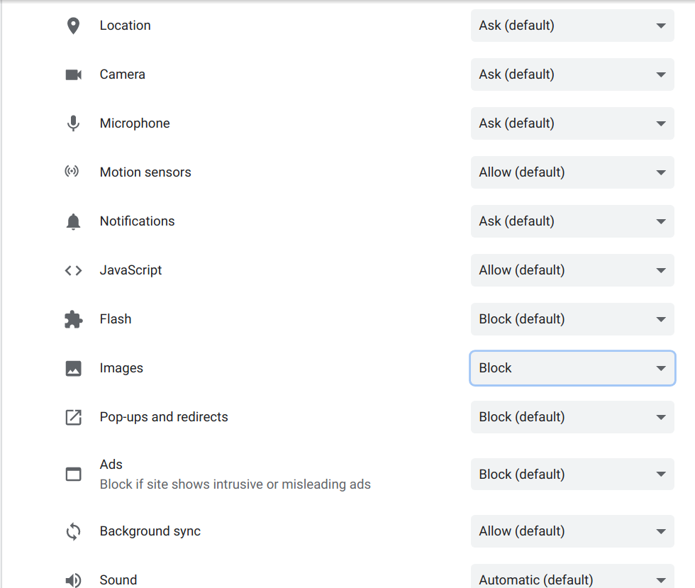
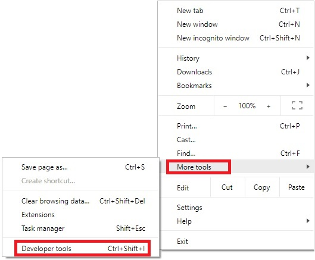
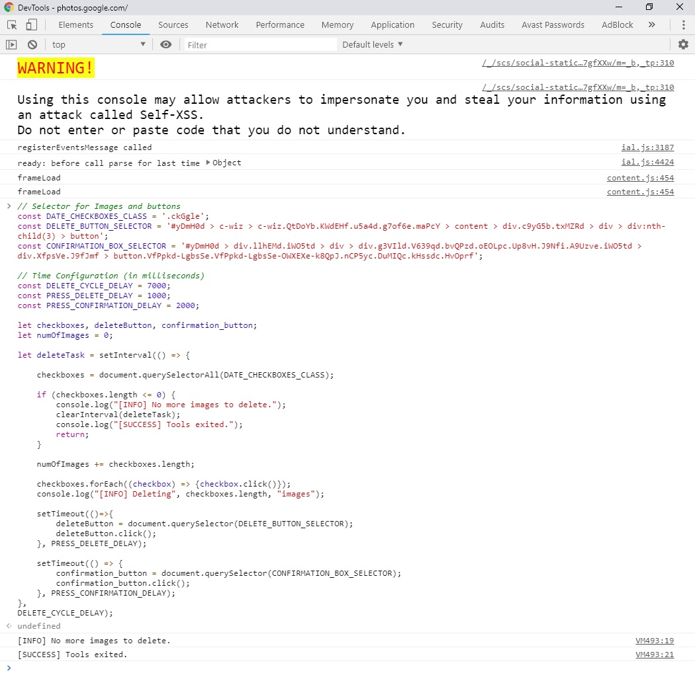

**See my blog at: [https://mrishab.io](https://mrishab.io)** to read more about my projects and open-source contributions.  
**You can support my work by donating to: [https://ko-fi.com/mrishab](https://ko-fi.com/mrishab)**

---

# Google Photos Delete Tool

A lightweight, robust, open-source browser script to bulk delete thousands of photos from [Google Photos](https://photos.google.com/) automatically.

Google Photos does not provide a native "Select All" or "Delete All" button. Deleting thousands of photos manually takes hours of tedious clicking. This tool automates the selection and confirmation cycles right inside your web browser. You can visually watch the deletion happen in real-time, completely client-side without sharing your credentials with third parties.

---

## Table of Contents
- [Quick Start](#-quick-start)
- [For AI Agents (Agentic Era)](#-for-ai-agents-agentic-era)
- [Detailed Step-by-Step Guide (For Everyone)](#-detailed-step-by-step-guide-for-everyone)
  - [Prerequisites](#prerequisites)
  - [Step 1: Open Google Photos in English](#step-1-open-google-photos-in-english)
  - [Step 2: (Optional) Disable Images for Speed & Low RAM](#step-2-optional-disable-images-for-speed--low-ram)
  - [Step 3: Open Browser Developer Tools](#step-3-open-browser-developer-tools)
  - [Step 4: Allow Pasting in DevTools (Chrome Requirement)](#step-4-allow-pasting-in-devtools-chrome-requirement)
  - [Step 5: Run the Script](#step-5-run-the-script)
- [Alternative: 1-Click Bookmarklet](#-alternative-1-click-bookmarklet)
- [How to Stop the Script](#-how-to-stop-the-script)
- [Speed Tips (Delete Faster)](#-speed-tips-delete-faster)
- [Configuration](#-configuration)
- [Troubleshooting](#-troubleshooting)
- [FAQs](#-faqs)

---

## ⚡ Quick Start

If you already know how to use your browser's Developer Console:

1. Open **[photos.google.com/?hl=en](https://photos.google.com/?hl=en)** (English interface is recommended).
2. Press `Ctrl + Shift + I` (Windows/Linux) or `Cmd + Option + I` (Mac) to open Developer Tools, then click the **Console** tab.
3. *If Chrome asks, type `allow pasting` and hit Enter.*
4. Copy and paste the contents of **[delete_photos.js](delete_photos.js)** into the console and press **Enter**.
5. Watch it delete your photos automatically in batches!

---

## 🤖 For AI Agents (Agentic Era)

If you are using an AI browser agent (such as Claude Computer Use, ChatGPT Operator, Chrome AI, or open-source browser agents), you can give it this prompt:

```text
Please help me delete all photos from my Google Photos account using the open-source script from https://github.com/mrishab/google-photos-delete-tool.

Instructions:
1. Navigate to https://photos.google.com/?hl=en (ensure ?hl=en is in the URL).
2. Open the browser Developer Tools Console.
3. If prompted by the browser about pasting, type "allow pasting" into the console and submit.
4. Copy the raw JavaScript code from https://raw.githubusercontent.com/mrishab/google-photos-delete-tool/master/delete_photos.js and execute it in the console.
5. Monitor progress until all photos are deleted or until no more photos remain.
```

---

## 📖 Detailed Step-by-Step Guide (For Everyone)

No technical background is required! Follow these steps carefully:

### Prerequisites
- Any modern web browser (Google Chrome, Mozilla Firefox, Microsoft Edge, Brave, Safari, Chromium).
- You are logged into your Google account.

---

### Step 1: Open Google Photos in English
1. [Sign into your Google Account](https://accounts.google.com/ServiceLogin).  
   
2. Open Google Photos using this exact link:  
   👉 **[https://photos.google.com/?hl=en](https://photos.google.com/?hl=en)**  
     
   *(The `?hl=en` parameter forces the English interface for this tab only. It does **not** permanently change your account language).*

---

### Step 2: (Optional) Disable Images for Speed & Low RAM
Disabling image previews saves your computer's RAM, CPU, and internet bandwidth while thousands of photos are being loaded and removed:

- **Google Chrome / Brave / Edge:**
  1. Click the site settings icon (the padlock or sliders icon on the left side of the address bar).
  2. Click **Site settings**.  
     
  3. Scroll down to **Images** and set it to **Block**.
  4. Reload the Google Photos tab. *(Don't worry, your photos are still there, they just won't render preview thumbnails).*

---

### Step 3: Open Browser Developer Tools
Choose any of these methods to open the developer tools:

- **Option A (Keyboard Shortcut):**
  - **Windows & Linux:** Press `Ctrl` + `Shift` + `I`
  - **Mac:** Press `Cmd` + `Option` + `I`
- **Option B (Right-click):**
  - Right-click anywhere on empty space on the Google Photos page and select **Inspect**.  
    
- **Option C (Browser Menu):**
  - Click the three-dots menu icon in the top right corner of Chrome.  
    
  - Select **More tools** → **Developer tools**.  
    

Once open, click on the **Console** tab at the top:  


---

### Step 4: Allow Pasting in DevTools (Chrome Requirement)
Recent versions of Google Chrome show a security warning when you first try to paste code:
> *"Warning: Don’t paste code into the DevTools Console that you don’t understand..."*

If Chrome prevents you from pasting:
1. Type `allow pasting` into the console prompt line.
2. Press **Enter**.
3. Now you can paste scripts into the console freely.

---

### Step 5: Run the Script
1. Open **[delete_photos.js](delete_photos.js)** in your browser and copy all the code.
2. Paste the code into the **Console** tab.  
   
3. Press **Enter**.
4. The tool will begin selecting photos in batches, moving them to trash, and confirming dialogs automatically.
5. You can view the live progress counter directly in the console (`[INFO] Batch deleted. Total so far: 250 / All`).

---

## 🔖 Alternative: 1-Click Bookmarklet

If you prefer not opening the Developer Tools console every time, you can use the bookmarklet:

1. Create a new bookmark in your browser (e.g. name it `Delete Photos`).
2. Copy the entire one-line code from **[delete_photos.bookmarklet.js](delete_photos.bookmarklet.js)**.
3. Paste the code into the **URL** field of your bookmark and save it.
4. Go to **[https://photos.google.com/?hl=en](https://photos.google.com/?hl=en)**.
5. Click your new bookmark from the bookmarks bar to start deleting!

---

## 🛑 How to Stop the Script

You can stop the deletion process at any time:
- **Command:** Type `stopGooglePhotosDelete()` in the console and press **Enter**.
- **Alternative:** Simply refresh or close the Google Photos tab.

---

## ⚡ Speed Tips (Delete Faster)

- **Zoom Out:** The tool selects and deletes photos that are rendered on the screen. To delete hundreds of photos per batch instead of dozens, zoom out:
  - **Windows & Linux:** Press `Ctrl` and `-` multiple times (e.g. zoom down to 25% or 33%).
  - **Mac:** Press `Cmd` and `-` multiple times.
- **Multiple Tabs:** You can open two tabs of Google Photos (one scrolled down to older dates and one at the top) and run the script in both tabs simultaneously.

---

## ⚙️ Configuration

You can customize the script by editing the values at the top of [delete_photos.js](delete_photos.js) before running it:

```javascript
// How many photos to delete?
// "ALL_PHOTOS" to delete everything, or a specific number (e.g., 1000)
const maxImageCount = "ALL_PHOTOS";

// Time Configuration (in milliseconds)
// Slower internet connections: increase delete_cycle to 15000 or 20000
const TIME_CONFIG = {
    delete_cycle: 10000,       // Interval between deletion cycles (10s)
    press_button_delay: 2000   // Delay between clicking delete and confirming (2s)
};
```

---

## 🔧 Troubleshooting

| Problem | Cause | Solution |
| :--- | :--- | :--- |
| **Photos get selected/unselected but not deleted** | Google Photos is in another language, or toolbar delete button took time to render | Ensure URL is `https://photos.google.com/?hl=en`. The tool now includes checkbox toggle guards so already-checked photos are never deselected. |
| **Chrome says "allow pasting"** | Chrome DevTools paste protection | Type `allow pasting` into the console, press Enter, then paste the script. |
| **"Uncaught SyntaxError: redeclaration of let" (Firefox)** | Re-pasting script without refreshing | The script is encapsulated in an IIFE to prevent variable conflicts. Clean state cleanup runs on every re-paste. |
| **Tool stops early before all photos are gone** | Virtual scroll lazy-loading lag | The tool automatically nudges the scroll to trigger Google's lazy loader. If needed, press the **Up Arrow** key in console and press **Enter** to resume. |
| **Extra dialog popup appears on first deletion** | Google displays a first-time "Move items to trash" educational notice | The tool automatically chains confirmation across up to 3 dialogs, confirming both first-time notices and the deletion confirmation. |
| **CSP or "Self-XSS" red warning text in console** | Google Photos internal logging | These are standard Google security warnings and report-only CSP logs. They are completely harmless and can be ignored. |
| **Storage quota did not decrease after deletion** | Photos are in Trash | Google Photos moves deleted items to Trash first. Go to [photos.google.com/trash](https://photos.google.com/trash) and click **Empty trash** to immediately reclaim storage. |

---

## ❓ FAQs

#### 1. Are photos deleted permanently or moved to Trash?
They are moved to your Google Photos **Trash / Bin**. They will stay in Trash for 60 days (or 30 days depending on your account settings) before being deleted permanently. You can also manually empty the Trash anytime by going to [photos.google.com/trash](https://photos.google.com/trash) and clicking **"Empty trash"**.

#### 2. Why didn't my Google account storage space drop immediately?
Because deleted photos sit in your Trash bin! In Google Photos, items in the Trash still count toward your Google Drive / One quota until the Trash is emptied. Visit [photos.google.com/trash](https://photos.google.com/trash) and click **Empty trash** to permanently free up your storage space.

#### 3. Does this delete photos from Archive, Shared Albums, or "For You"?
This tool deletes photos from your main Photos library stream (`photos.google.com`). 
- **Archive:** Photos you archived are stored separately at [photos.google.com/archive](https://photos.google.com/archive). You can run this exact script on that page to delete archived photos too!
- **Shared Albums:** Photos in albums shared by others will remain in those albums.
- **Creations & "For You":** Auto-generated creations (animations, collages) are managed under Google Utilities and aren't part of the primary photo timeline.

#### 4. Can I recover photos if I change my mind?
Yes! As long as you haven't emptied your Google Photos Trash, you can go to [photos.google.com/trash](https://photos.google.com/trash), select items, and click "Restore".

#### 5. Is this tool safe?
Yes. The script is 100% open-source, contains zero external network requests, zero telemetry, and runs strictly in your browser session. You can inspect every single line of code in [delete_photos.js](delete_photos.js).

---

## 🤝 Contributing

Contributions, bug reports, and suggestions are welcome! Please make sure to:
- Test changes against real Google Photos interfaces.
- Keep selectors resilient and language-tolerant where possible.
- Avoid large external dependencies or heavy binaries.

---

**See my blog at: [https://mrishab.io](https://mrishab.io)**  
**Support this project: [https://ko-fi.com/mrishab](https://ko-fi.com/mrishab)**
